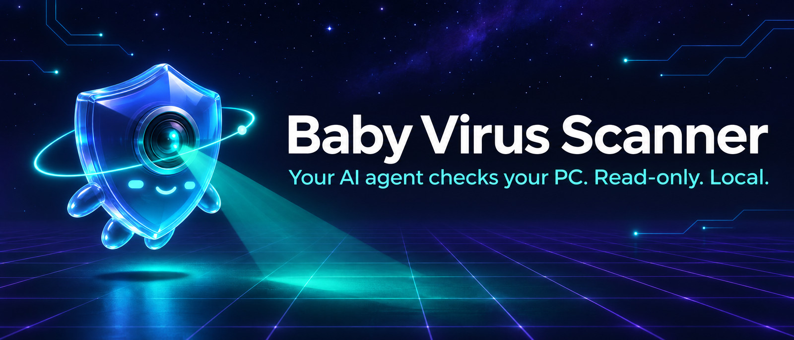
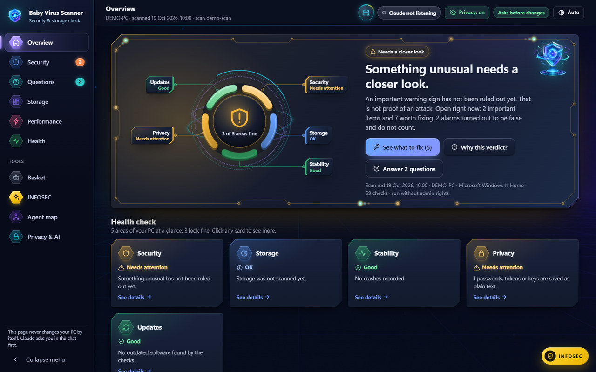
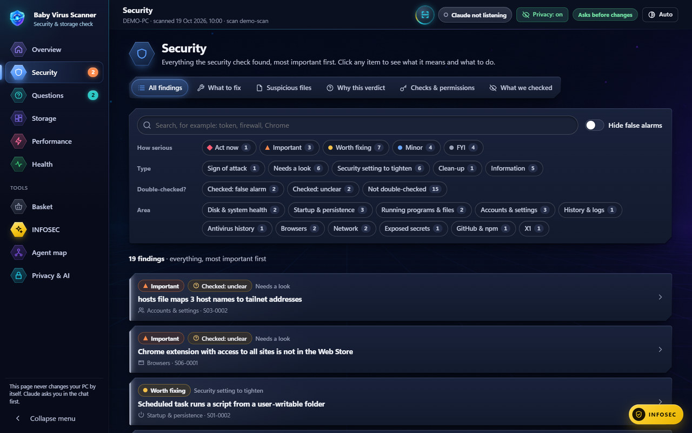
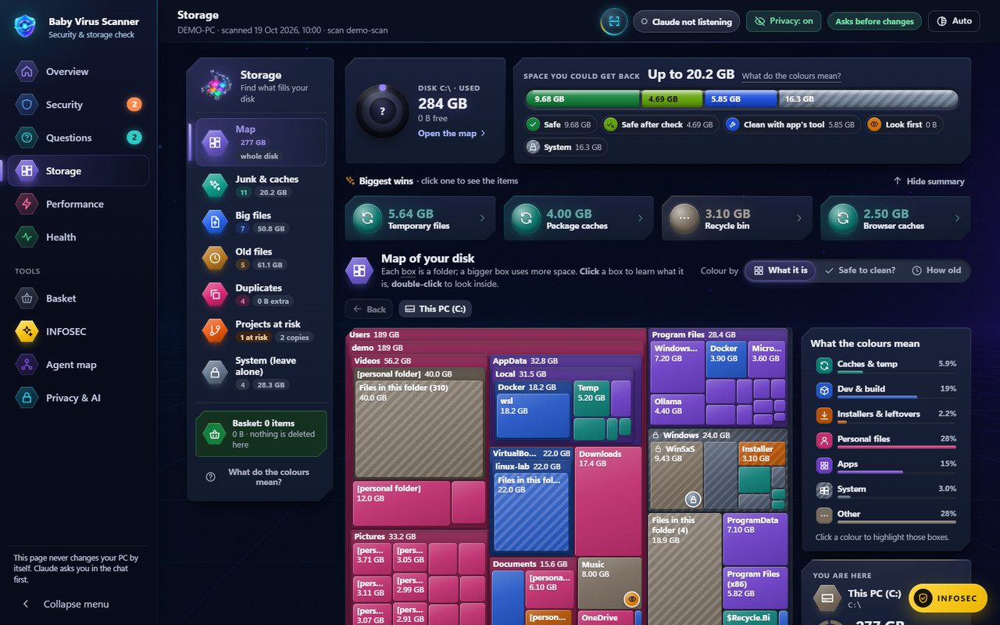
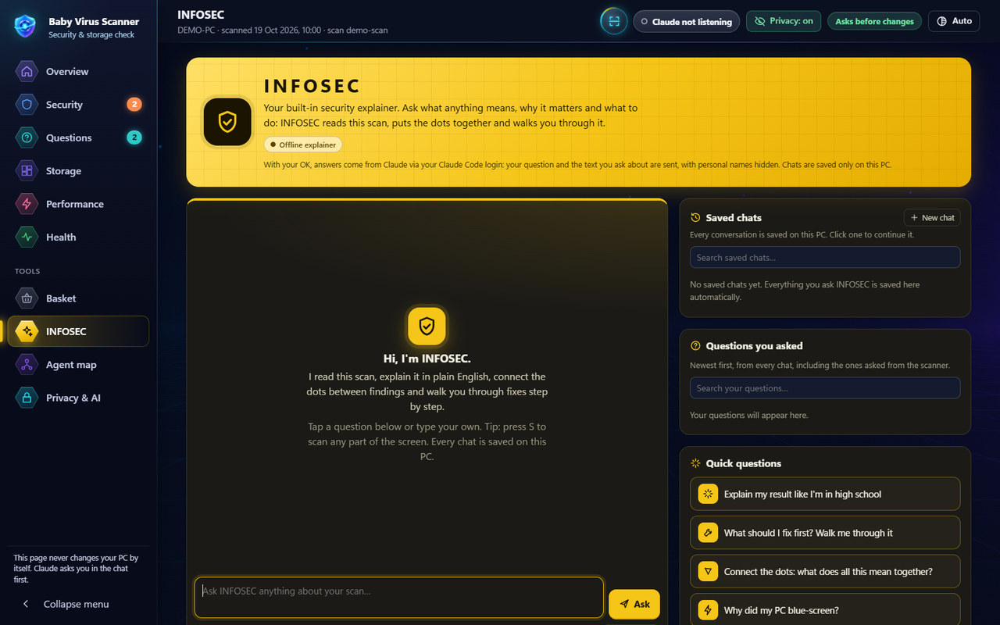
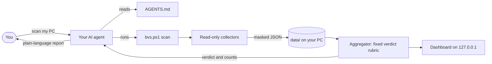

<p align="center">
  
</p>

<p align="center">
  
  
  
  
  
  
  
</p>

# baby-virus-scanner

A local, read-only **"have I been hacked?"** check and **storage-health map** for Windows, built
to be run by the AI coding agent you already use. You clone it, tell your agent "scan my PC",
and get a verdict you can understand, with the evidence behind it.

Classic antivirus asks "is this file a known virus?". This asks a wider question: *is anything on
this PC, or in its accounts, behaving like an intruder?* It looks for:

- persistence tricks (Run keys, scheduled tasks, services, WMI, COM hijacks);
- hijacked browsers and malicious extensions;
- remote-access tools and rogue accounts;
- interception of your traffic (rogue root certificates, proxies, DNS hijacking);
- developer supply-chain malware (npm and PyPI worms, malicious editor extensions);
- abuse of AI-tool configuration (hooks, MCP servers, poisoned skills and instruction files);
- traces of account takeover on GitHub and npm.

Then it maps your disk (large, old, duplicate and junk files, programs that slow the PC, broken
references) so you can clean up safely.

It is not a replacement for real-time antivirus. See [Honest limits](#honest-limits).

## Run it with your AI agent

1. **Get the code.** `git clone https://github.com/Martysunshine/baby-virus-scanner.git`
2. **Open the folder in your agent** and say: *scan my PC*.
3. **Answer its questions.** It asks before it starts, and separately before anything optional.
   Every default is "no".

The agent reads [AGENTS.md](AGENTS.md), which tells it exactly what to run, in which order, what
to ask you first and what it must never do.

| Your agent | How to start |
|---|---|
| Claude Code | Open the folder and type `/scan`, or just ask. |
| Codex, Cursor, opencode, goose, Zed and other tools that read `AGENTS.md` | Open the folder and ask it to scan your PC. |
| Anything else with a terminal tool, including local models | Paste the prompt from [docs/agent/START-HERE.md](docs/agent/START-HERE.md). |
| No agent | Use the [manual quick start](#manual-quick-start). |

**Who does what.** Detection is ordinary code: PowerShell collectors with fixed rules, and a
fixed rubric for the verdict. Same input, same output. Your agent runs it, explains the result in
plain words and, if it is capable enough, double-checks serious findings by a second method. The
agent cannot set the verdict.

## What you get

<table>
  <tr>
    <td width="50%"><br><sub><b>Overview.</b> One verdict in plain English, and the areas behind it.</sub></td>
    <td width="50%"><br><sub><b>Security.</b> Every finding with its evidence, why it may be harmless, and what to do.</sub></td>
  </tr>
  <tr>
    <td><br><sub><b>Storage map.</b> What fills the disk, and what is safe to remove.</sub></td>
    <td><br><sub><b>INFOSEC.</b> A built-in explainer; AI answers only if you opt in.</sub></td>
  </tr>
</table>

<sub>Screenshots show the synthetic demo scan (`DEMO-PC`). See it yourself, without scanning anything: <code>pwsh -File .\bvs.ps1 demo</code></sub>

## How it works



| ID | Module | What it answers |
|---|---|---|
| S01 | Persistence | What starts automatically or hijacks execution? |
| S02 | Processes and files | What is running, and what risky files appeared recently? |
| S03 | Accounts and posture | Rogue accounts, remote-access tools, interception (roots, proxy, hosts), security settings |
| S04 | History and logs | "Paste this command" scams, PowerShell and BITS activity, new services, remote logons |
| S05 | Antivirus evidence | What have the installed security products already detected, and is it still there? |
| S06 | Browsers | Malicious or risky extensions, hijacks, notification spam, debug-port abuse |
| S07 | Network | Connections, exposed listeners, firewall, DNS hijack test, Wi-Fi, VPN overlays |
| S08 | LAN | Which devices are on my network, and what has the router port-forwarded? Passive unless you agree |
| S09 | AI tools | Hooks, MCP servers, plugins, skills, instruction files, transcripts (exfiltration patterns) |
| S10 | Editors and git | Editor extensions, auto-run tasks, git configuration traps |
| S11 | Supply chain | Malicious npm and PyPI packages installed, cached or run |
| S12 | Secrets exposure | Where plaintext secrets sit and whether they are exposed |
| S13 | GitHub and npm | Unknown keys, repositories, tokens, unauthorized publishes |
| G0 to H2 | Inventory, storage, duplicates, programs, health | The storage map and the health view |

Each module's method is written down in [docs/playbooks/](docs/playbooks/).

## Safety guarantees

| Guarantee | How it is enforced |
|---|---|
| **Read-only.** Scanning never deletes, quarantines or changes anything. | Every collector must pass an AST linter (`src/tools/windows/check-collector.ps1`) that blocks file, registry, service, task, firewall and antivirus changes, installs, elevation and raw network calls. System state is recorded before and after, and the comparison is saved with the scan. |
| **Secrets never leak.** | Masking is built into the writer and fails closed. Browser password, cookie and history databases, AI-tool credential files and private keys are on a never-open list (`src/config/never-read.json`). |
| **Minimal network.** | Collectors reach only the hosts in `src/config/intel-hosts.json`. What may leave: package `name@version`, extension IDs, your GitHub user name and npm package names, DNS test names. Never file contents, paths or hashes. Two programs can be downloaded, only when you ask: see [Optional extras](#optional-extras). |
| **Local only.** | Results stay in `data/` in this folder. The dashboard binds to `127.0.0.1` and checks Host, Origin and a per-start token. No accounts, no telemetry. |
| **AI is opt-in.** | Your agent asks before it reads findings. The dashboard's explainer asks in the browser before its first AI request, hides personal file names first, and can be switched off completely (`--no-ai`). |
| **You decide every deletion.** | The dashboard cannot delete. It can only send a request, which needs two confirmations typed by you: one in the dashboard, then a one-time code in the agent chat. Items go to the Recycle Bin or a holding folder. The scanner never edits the registry. |

More: [docs/PRIVACY.md](docs/PRIVACY.md), [docs/AI-COMPLIANCE.md](docs/AI-COMPLIANCE.md).

## Requirements

- Windows 10 or 11.
- [PowerShell 7](https://learn.microsoft.com/powershell/scripting/install/installing-powershell-on-windows) (7.2 or newer; 7.4+ recommended).
- [Python 3.9+](https://www.python.org/downloads/) for the report and the dashboard. Standard library only.
- No administrator rights. No packages to install.

Check everything with `pwsh -NoProfile -ExecutionPolicy Bypass -File .\bvs.ps1 doctor`.

## Manual quick start

```powershell
pwsh -NoProfile -ExecutionPolicy Bypass -File .\bvs.ps1 doctor              # can this PC run it? changes nothing
pwsh -NoProfile -ExecutionPolicy Bypass -File .\bvs.ps1 scan -Parallel 4    # the whole read-only scan, 15 to 40 minutes
pwsh -NoProfile -ExecutionPolicy Bypass -File .\bvs.ps1 dashboard           # http://127.0.0.1:8777 (or double-click start-dashboard.cmd)
```

`scan` runs, in order: a new scan session, a system snapshot, the file-system inventory, the
security modules, the report and verdict, the storage and health modules, the report again, and
a second snapshot with the comparison. Useful variations:

| Command | What it does |
|---|---|
| `bvs.ps1 scan -Lan` | Also discover devices on your own home network (sends pings and router queries). |
| `bvs.ps1 scan -Background` | Start detached; follow it with `bvs.ps1 status`. |
| `bvs.ps1 scan -Resume` | Continue an interrupted scan. |
| `bvs.ps1 security -Only S01,S07` | Run single modules, then `bvs.ps1 report`. |
| `bvs.ps1 demo` | Open the dashboard on synthetic data. |
| `bvs.ps1 help` | Every command. |

If you downloaded a ZIP instead of cloning, Windows marks the files as downloaded; keep the
`-ExecutionPolicy Bypass` shown above.

## Optional extras

Experimental in 0.1: included, off by default, not yet verified end to end.

| Extra | What it adds | What it needs from you |
|---|---|---|
| Admin checks | Read-only checks that need administrator rights (Security log, hidden tasks, boot integrity, disk health) and a report-only pass of Microsoft Safety Scanner. | `bvs.ps1 get-tools -Msert` downloads the scanner from Microsoft and keeps it only with a valid Microsoft signature. `bvs.ps1 admin` then shows one Windows admin prompt. |
| Signed-in GitHub checks | Deploy keys, webhooks, runners, collaborators and private events of your own repositories. | `bvs.ps1 get-tools -Gh` downloads a pinned GitHub CLI (hash and signature verified). You sign in yourself with `bvs.ps1 github-login` and sign out with `bvs.ps1 github-logout`. |

## Known side effects

A read-only scan still leaves traces. None of them is a change made by the scanner.

- **Event logs:** its queries create entries (PowerShell, WMI-Activity). The scan's start time is
  recorded so those entries are not counted as findings.
- **DNS cache:** entries from threat-intelligence lookups.
- **Your antivirus** scans files as they are read, and may look twice at the indicator lists in
  this folder. They are detection patterns, not malware.
- **Windows root-certificate auto-update:** when a signature is verified, Windows may install a
  trusted root from Microsoft's list by itself.
- **Background activity** of Windows and apps appears in the before/after comparison.

## Honest limits

- This is not real-time protection. Keep your antivirus.
- A scan from inside Windows cannot fully rule out a kernel rootkit, a firmware implant or a
  compromised router.
- Cloud accounts without an API must be checked by hand; the report lists the exact pages.
- A missing log entry is not proof of a clean system.
- The verdict is as good as its coverage. The report says what could not be checked.
- AI explanations can be wrong. Findings and the verdict come from the scanner, not from a model.

## Project layout

```
AGENTS.md              runbook for AI agents
bvs.ps1                command-line entry point
start-dashboard.cmd    double-click to open the dashboard
src/
  collectors/          S01..S13 security modules, G0 inventory, G1/G2/H1/H2 storage and health
  lib/                 shared collector library (masking, safe enumeration, signatures, intel)
  admin/               elevated read-only checks and their launcher
  core/                Python: aggregator and verdict, dashboard data, AI bridge, signals
  server/              hardened localhost dashboard server
  dashboard/           the dashboard (plain HTML, CSS and JavaScript)
  tools/               linter, scan session, snapshots, privacy check, delete protocol
  config/              masking rules, never-read list, host allowlist, storage rules
docs/                  rules, data contract, methodology, playbooks, agent briefs, policies
tests/                 self-tests, server tests, synthetic demo scan
data/ intel/ logs/     your scan output (created on first run, never committed)
```

## Documentation

- [AGENTS.md](AGENTS.md): the agent runbook.
- [docs/METHODOLOGY.md](docs/METHODOLOGY.md): how a scan is carried out and judged.
- [docs/ARCHITECTURE.md](docs/ARCHITECTURE.md), [docs/schema.md](docs/schema.md): design and data contract.
- [docs/agent-rules.md](docs/agent-rules.md): the safety contract for collectors.
- [docs/ROADMAP.md](docs/ROADMAP.md): what comes next, including Linux.

## Contributing and security

Contributions are welcome: see [CONTRIBUTING.md](docs/CONTRIBUTING.md). Run the privacy check before
every commit, and never attach scan output to an issue. To report a vulnerability, see
[SECURITY.md](docs/SECURITY.md).

## License

[Apache License 2.0](LICENSE). Copyright 2026 Martysunshine. Third-party data and programs:
[THIRD-PARTY-NOTICES.md](docs/THIRD-PARTY-NOTICES.md).
